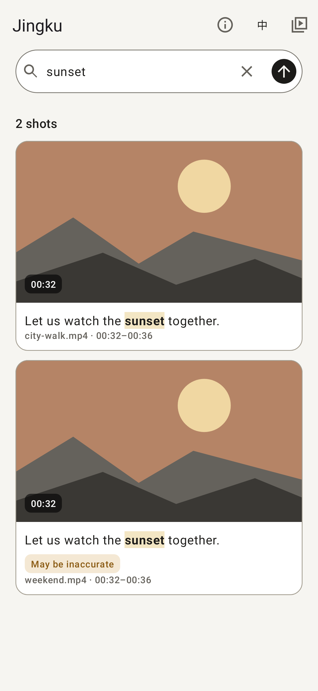

# Jingku · 镜库

Find the moment someone said it—in your local videos, with a sentence.

[简体中文](README.zh.md) · [License audit](docs/LICENSING.md) · [Release notes](RELEASE_NOTES.md)

An Android dialogue-search prototype: import local videos, transcribe with SenseVoiceSmall, embed with EmbeddingGemma 2, and tap cosine Top-3 results to play at the matching timestamp. Chinese is the default; English and system light/dark themes are supported. No video upload. Models ship with the APK/AAB; preparation, indexing and retrieval run locally without network access.

## Features

Multi-video import, cancellable sequential indexing with per-video/overall progress, background video thumbnails, literal transcript highlighting, timestamps, and inline playback. Semantic matches without literal query overlap do not receive invented highlights. Scores below the frozen iter1 S2 reference `0.7889297604560853` show “May be inaccurate.” Cosine is not a correctness probability. Results remain visible; no judge model or hard refusal is used.

## Run and build

**Android 8+ / API 26; arm64-v8a only. Not tested on a physical device.** Wait for automatic offline model preparation, import videos you have the right to process, index, and search. Cancellation removes the unfinished video's partial index and keeps previously completed videos. See [bundled models and terms](docs/MODELS.md).

Use JDK 17+, Android SDK 35, Build Tools 35.0.0:

```sh
cd android
export ANDROID_HOME=/path/to/android-sdk
./gradlew testReleaseUnitTest lintRelease bundleRelease
```

Place the four pinned model files in ignored `models-cache/` next to `android/`; see docs/MODELS.md. Gradle obtains dependencies from Google Maven, Maven Central and JitPack. The AAB is unsigned by default; sign it and generate a universal APK with bundletool using your signing key. Verify with Android Build Tools `apksigner verify`. Keep signing material outside source control. The source repo contains no APK, model weights, videos, keystores or passwords.

## Evaluation and limitations

Historical iter5 real-test: 10 videos, 100 queries (62 answerable / 38 unanswerable), searched against a 14-video / ~70-minute corpus. **Top-3 timestamp hit 75.81% (~76%); Top-1 58.06% (~58%)**, both over the 62 answerable queries. A hit requires the correct video and the returned window midpoint inside the label tolerance. Video-cluster bootstrap 95% intervals: [65.57%, 86.44%] and [45.00%, 71.88%].

Historical optional refusal at the separate iter5 dev-calibrated threshold `0.743815303`: **58.00% refusal** across all queries, **28.95% false acceptance** among unanswerable queries; accepted timestamp hits 33.87% among answerable queries. This release always shows Top-3 and uses a warning rather than that refusal policy.

**Labels are AI-audited, not human listening ground truth.** Whisper can miss words or hallucinate. The reviewer saw the listener's annotations, so votes are not independent. All 31/140 low-confidence labels were retained; 8 previous yes labels became no because ASR evidence was insufficient, which does not establish absence from the original audio. The small VOA/ICANN corpus limits generalization.

**The release APK has not been tested on a physical device or reevaluated end to end. The 76% figure is not measured APK accuracy.** Android inherits iter2's LiteRT EmbeddingGemma 2 artifact, prefixes, ≤4-second dialogue windows and token/segment-start seeking. Historical offline evaluation used different model representations/prefixes and midpoint scoring. The iter1 threshold is an uncalibrated historical warning reference for this app. Noise, negation, factual differences and cross-language queries can fail.

The judge-model route failed its preregistered iter6 success criterion and has ended. Only SenseVoice + EmbeddingGemma cosine Top-3 ships; there is no judge, translation or cloud retrieval.

## License and privacy

Original app source: [MIT](LICENSE). Dependencies and models retain separate terms. SenseVoiceSmall weights use the custom FunASR model agreement, **not MIT**; upstream commercial-use interpretation still awaits final confirmation. See [the license audit](docs/LICENSING.md).

Bundled model preparation needs no network; the app has no INTERNET permission. Selected video content, transcripts and vectors stay in app-managed storage. Uninstall removes app data, while source videos remain with their provider. Android automatic app backup is disabled; manage device and file sharing according to your privacy needs.

## Real Android layout renders

56 native-Skia renders of production XML, demo state and abstract placeholder thumbnails; these are not device inference/playback evidence. Chinese/English, light/dark; [provenance and full list](screenshots/1.0.3/README.md).

[Home](screenshots/1.0.3/home-empty-en-light.png) · [主页](screenshots/1.0.3/home-empty-zh-light.png) · [Results](screenshots/1.0.3/search-results-en-light.png) · [深色结果](screenshots/1.0.3/search-results-zh-dark.png) · [Progress](screenshots/1.0.3/indexing-progress-en-light.png)


